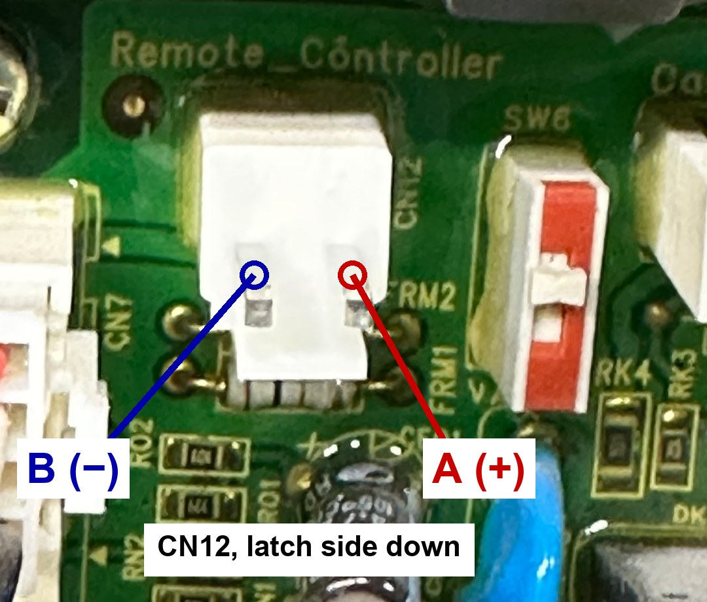
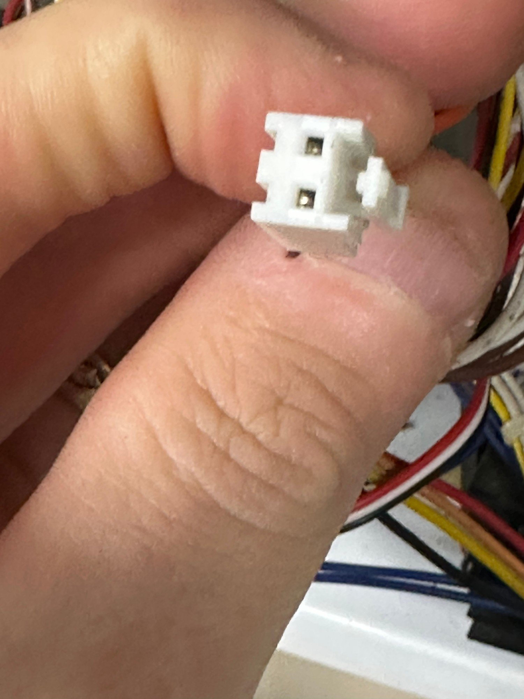
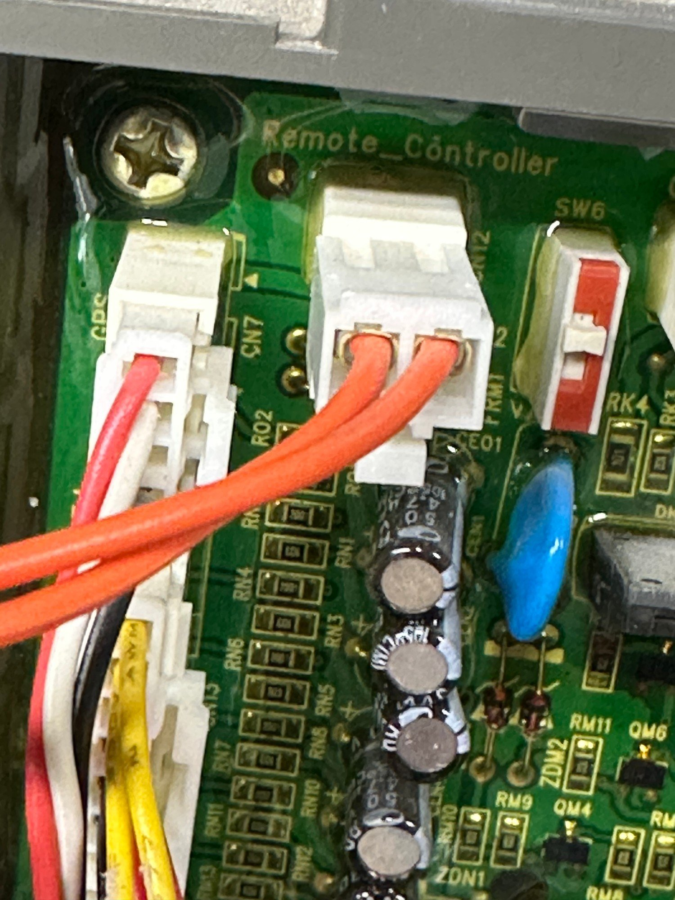
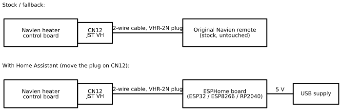
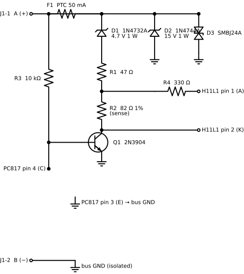
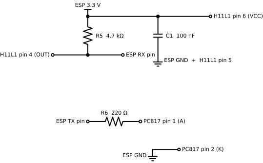
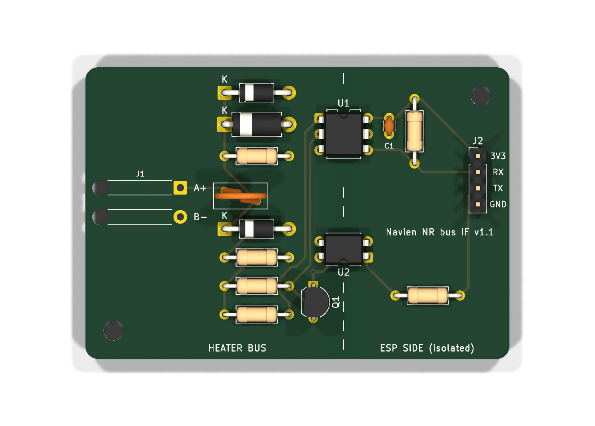

# Hardware

The board **replaces the wall remote**. The remote's cable plugs into connector **CN12** on the heater's control board.
The ESP board has a premade VH pigtail soldered on, so swapping between the remote and the board means moving one plug.

## Connecting to the heater

| | |
|---|---|
| Heater connector | **CN12**, silk-screened `Remote_Controller`, on the main control board (NR-210A) |
| Type | **JST VH**, 2-pin, 3.96 mm pitch. Mating plug: **VHR-2N**. Easiest: a premade VH 2-pin female pigtail ("VH3.96 2P with wires"), soldered to the board |
| Pin A (+) | **right-hand pin** when looking at the connector with its latch side down |
| Pin B (−) | left-hand pin |
| Protection on the heater side | FRM1 / FRM2: fusible resistors in series with both lines |

The remote's cable with its VH plug, and plugged into CN12:

 

**Reversed wiring is safe.** If A and B are swapped, the board's 15 V zener (D2) conducts forward and holds the line near 0.8 V.
The heater limits the current to ~12.5 mA and nothing sees more than ~0.8 V in reverse. It just won't communicate: the *Heater link* sensor stays off.
Flip the wires and it works. To check with a meter: with the original remote connected, A is the wire that reads **+6.5 to 8 V** relative to B.

**Power:** CN12 can't power the ESP board (the line delivers ~85 mW), so the ESP board needs its own supply, usually USB. The interface board takes its 3.3 V from the ESP board.

The interface board uses two optocouplers, one transistor and a handful of passives (about 14 parts).
It is **isolated**: the ESP board never shares ground with the heater, so any USB supply, a laptop, or a device shared with other sensors is fine.

How the bus works (details in [../docs/protocol.md](../docs/protocol.md)): the heater feeds the line with a ~12.5 mA current source (≈20 V open circuit).
The remote **clamps** it to ≈6.5 V. To send a '1', the heater raises its current to ≈24 mA (the clamp rises to ≈8 V), and the remote **releases** its clamp (the line rises to ≈15 V).
The board copies the original remote's clamp: ≈4.7 V zener + ≈130 Ω.

---

## Interface board

> New to electronics? The **[Detailed walkthrough of circuit operation](circuit-walkthrough.md)** explains what every part on this board does, with the numbers.

### Bus side (isolated from the ESP)

### ESP side

* **Idle:** R3 biases Q1 on from the bus itself, so the clamp D1 + R1 + R2 holds ≈6.5 V. This is also what the heater sees if the ESP crashes or loses power: a quiet remote.
* **Receive:** the clamp current flows through R2 (82 Ω, the sense resistor). At idle (13 mA) R2 drops 1.1 V, too little to light the H11L1's LED through R4. When the heater sends (24 mA), R2 drops 2.0 V, the LED gets ≈2.5 mA, and the H11L1 (with its Schmitt-trigger output) pulls the RX pin low.
* **Transmit:** the TX pin HIGH lights the PC817, which pulls Q1's base low and opens the clamp. The heater's current then flows into D2 and the line rises to ≈15 V, a '1' to the heater. The PC817 switches in microseconds, comfortably fast for the 500 µs half-bit.

<b>Why two different optocouplers?</b> (Can't both be the same part?)

 

They do different jobs, and neither part does the other's job well.

**Receive needs a threshold (H11L1).** The heater's signal is only a 0.9 V swing across R2 (1.1 V idle → 2.0 V sending). The H11L1 switches at a fixed LED current (≤ 1.6 mA) with hysteresis and a clean logic edge, the same on every part.
A PC817 here would act as an analog part. Its output follows its LED current, and its CTR spreads from 50 % to 600 % between parts, so the switching point would differ from board to board.
At idle its LED would already be partly on, so the RX pin would see slow, half-on edges with no hysteresis. Manchester decoding relies on edge timing, so that eats into the margin.

**Transmit is just a switch (PC817).** About 9 mA into the LED drives the output far harder than Q1's base needs (~0.6 mA through R3), even with a low-CTR part, and microsecond switching is plenty at 1 kbit/s.
An H11L1 here would need its own supply on the *bus* side, where its output is, and there isn't one. Feeding it from the bus would put it near its 16 V limit while transmitting.
It would also take a few mA from the heater's 12.5 mA current source, which shifts the receive thresholds.

**Using two PC817s** is possible only with a Schmitt buffer (e.g. 74HC14) added before the RX pin, which adds a part instead of removing one. PC817s cost cents and are sold singly or in small packs, so keeping both parts is the simpler option.

| Ref | Qty | Part | Notes |
|---|---|---|---|
| U1 | 1 | **H11L1** (DIP-6) | optocoupler with Schmitt-trigger output. 1 = LED anode, 2 = LED cathode, 4 = OUT, 5 = GND, 6 = VCC |
| U2 | 1 | **PC817** (DIP-4) | 1 = anode, 2 = cathode, 3 = emitter, 4 = collector |
| Q1 | 1 | 2N3904 | |
| D1 | 1 | 1N4732A | 4.7 V 1 W zener, band toward the bus + |
| D2 | 1 | 1N4744A | 15 V 1 W zener, band toward the bus + |
| D3 | 1 | P6KE24CA (through-hole) or SMBJ24A | 24 V bidirectional TVS (the PCB uses the P6KE24CA) |
| F1 | 1 | PTC fuse, 50 mA hold | e.g. Bel Fuse 0ZRE0005FF (the PCB footprint) |
| R1 | 1 | 47 Ω | trims the idle voltage, 39–56 Ω |
| R2 | 1 | 82 Ω 1 % | sense resistor (can be made from prallel 100 Ω + 470 Ω) |
| R3 | 1 | 10 kΩ | |
| R4 | 1 | 330 Ω | H11L1 LED |
| R5 | 1 | 4.7 kΩ | pull-up to 3.3 V |
| R6 | 1 | 220 Ω | PC817 LED (~9 mA from 3.3 V) |
| C1 | 1 | 100 nF | H11L1 VCC decoupling |
| J1 | 1 | Premade JST VH 2-pin female pigtail | soldered to the board; its plug goes onto CN12. A = wire on CN12's right pin (latch down) |
| — | 1 | ESPHome board: ESP32 (any model), ESP8266 or RP2040 | dedicated, or an existing device with two free GPIOs |
| — | 1 | 5 V USB supply, ≥ 1 A | |

**Wiring list, bus side** (each row is one node, and none of these touch ESP GND):

| Node | Joins |
|---|---|
| BUS_A | J1-1 via F1 · D1 cathode · D2 cathode · D3 · R3 |
| CLAMP_1 | D1 anode · R1 |
| SENSE_TOP | R1 · R2 · R4 |
| H11L1_A | R4 other end · U1 pin 1 |
| SENSE_BOT | R2 other end · Q1 collector · U1 pin 2 |
| Q1_BASE | R3 other end · Q1 base · U2 pin 4 |
| BUS_GND | J1-2 · Q1 emitter · D2 anode · D3 other end · U2 pin 3 |

**Wiring list, ESP side:**

| Node | Joins |
|---|---|
| 3V3 | ESP 3V3 · U1 pin 6 · R5 · C1 |
| RX | ESP RX pin · U1 pin 4 · R5 other end |
| TX_LED | ESP TX pin via R6 · U2 pin 1 |
| GND | ESP GND · U1 pin 5 · U2 pin 2 · C1 other end |

Keep a few millimetres between the bus-side and ESP-side copper (the PCB below keeps ≥ 4.7 mm).

### Ready-made PCB

A 67 × 46 mm two-layer, all-through-hole board in [pcb/](pcb/):

| File | Use |
|---|---|
| [`pcb/fab/navien-bus-if-gerbers.zip`](pcb/fab/navien-bus-if-gerbers.zip) | **Upload this to the PCB maker** (JLCPCB, PCBWay, OSH Park, …). Gerbers + Excellon drill files |
| [`pcb/fab/BOM.csv`](pcb/fab/BOM.csv) | parts to buy, by reference |
| [`pcb/navien-bus-if.kicad_pcb`](pcb/navien-bus-if.kicad_pcb) | KiCad 10 board, to view or edit |
| [`pcb/make_pcb.py`](pcb/make_pcb.py) | regenerates the board (placement, routing, pours) from the circuit |
| [`pcb/check_pcb.py`](pcb/check_pcb.py) | re-checks netlist vs. circuit, connectivity and isolation distance |

Order settings: 2 layers, 1.6 mm FR-4, 1 oz copper, any colour/finish. Default rules are fine: 0.4 mm tracks, 0.3 mm clearance, 0.4 mm smallest drill.
The board passes KiCad's DRC with no warnings, and its netlist was checked against the wiring list above.

Assembly notes:
* Zener bands (cathode) go toward the **K** marks. D3 (TVS) is bidirectional.
* U1's pin 1 is top-left. U2 is rotated: its pin 1 is bottom-right, on the ESP side.
* **No connector on the board.** Buy a premade **JST VH 2-pin female pigtail** (20–22 AWG leads). Its plug goes onto CN12, and its two wires are soldered to J1: feed each wire up through the big strain-relief hole at the board edge, then down into its pad. The wire on CN12's **right-hand pin (latch down) goes to A+**. Swapped wires do no harm, it just won't talk.
* J2 goes to the ESP board with jumper wires: 3V3 → 3.3 V, GND → GND, RX → the pin set as `navien_rx_pin`, TX → `navien_tx_pin`. Any of the chip's own GPIOs works (see the main README's Pins section); an I2C port expander does not.

---

## Bring-up

Test the board on the bench before connecting it to the heater. **Step-by-step instructions, with expected readings and troubleshooting, are in [bring-up.md](bring-up.md).**
In short, using a 20 V supply and a 1.1 kΩ resistor (or the supply's current limit, or an LM317L) as a fake heater:

1. **Idle:** A+ to B− reads **≈ 6.5 V** (trim R1 if needed).
2. **Receive:** adding ≈ 12 mA (1 kΩ from 20 V to A+) lifts the line to **≈ 8 V** and pulls **RX low**.
3. **Transmit:** TX high lifts the line to **≈ 15 V**.
4. **Fail-safe:** with the ESP side unpowered, the line still idles at ≈ 6.5 V.
5. **On the heater:** move the CN12 plug to the board and check *Heater link*, the temperatures, burner and pump. Anything odd? Move the plug back to the remote.

---

## Other ideas

[Other ideas, untested](other-ideas.md) has a comparator design with a listen-only mode, for sniffing the bus alongside the original remote, and the `navien_2wire_b` component that goes with it.
Neither has been built or tested.
