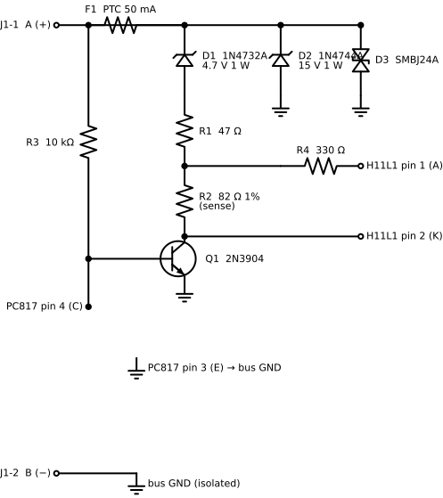
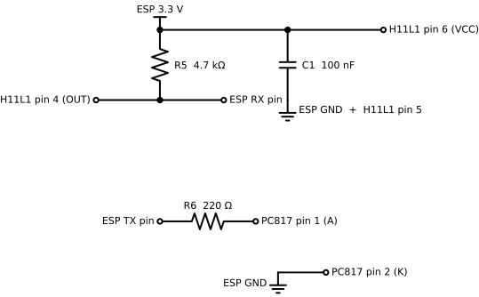
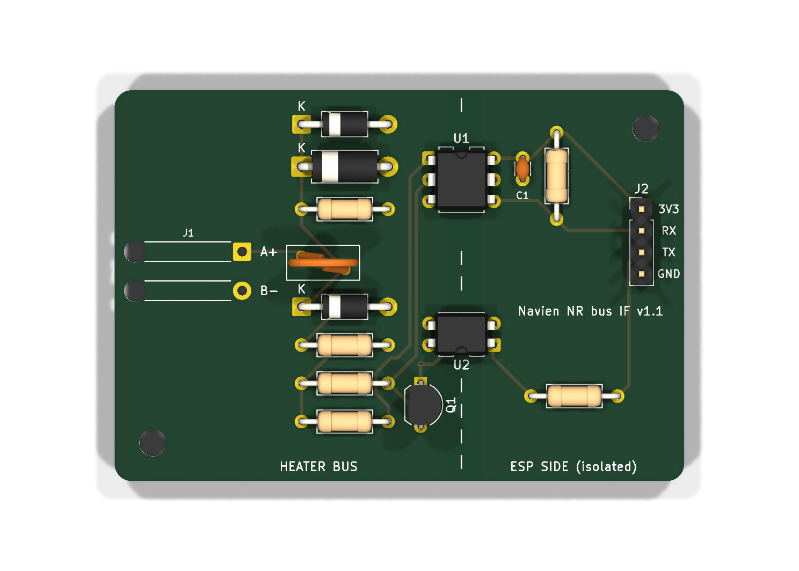

# Detailed walkthrough of circuit operation

This page explains how the isolated interface board works, one component at a time.
It assumes no electronics background beyond knowing what voltage and current are. Part names (R1, Q1, …) match the
schematics, the [parts list](README.md#interface-board) and the silkscreen on the [PCB](pcb/).

Keep the two schematics open while reading:

| Heater side (isolated bus side) | ESP side |
|---|---|
|  |  |

Click a schematic to open it full size.

Contents:
1. [The key idea: how the two wires work](#1-the-key-idea-how-the-two-wires-work)
2. [The parts, in the order the current meets them](#2-the-parts-in-the-order-the-current-meets-them)
3. [Why the board is "isolated"](#3-why-the-board-is-isolated)
4. [What happens when things go wrong](#4-what-happens-when-things-go-wrong)
5. [Where each part is on the PCB](#5-where-each-part-is-on-the-pcb)

---

## 1. The key idea: how the two wires work

Picture the heater's two wires as a **garden hose with a pump that always pushes the same amount of water**: about **12.5 mA** of current.
Electrically, the heater is a *current source*. It pushes that current no matter what is connected, up to about 20 V.

- **With nothing connected,** the current has nowhere to go and the voltage rises to the heater's maximum (19.8 V measured).
- **The original wall remote** acts like a **pressure-relief valve set at about 6.5 V**: it lets the current through while holding the voltage there. That is the "idle" state.

Both sides send messages without breaking that arrangement:

| Who sends | How | What the wires show |
|---|---|---|
| **Heater** sends a '1' | pushes **more current**: 12.5 mA becomes about 24 mA | the valve is pushed a bit harder, so the voltage rises **6.5 V → 8 V** |
| **Remote** (our board) sends a '1' | **closes the valve** briefly | the voltage shoots up until something else lets the current through, at about **15 V** |

The board's job is to be that **valve** (to hold the line at the right voltage), to **notice when the heater pushes extra current**,
and to **close the valve on command** from the ESP. The bit timing and message format are described in [../docs/protocol.md](../docs/protocol.md).

---

## 2. The parts, in the order the current meets them

All of these are on the **heater side** schematic ([vb_bus.svg](schematics/vb_bus.svg)) unless noted.

### Wire entry and protection

**J1, solder pads with strain-relief holes.**
The premade JST VH pigtail is soldered here, and its plug goes onto the heater's CN12 connector.
Each wire goes through a large hole first, so a tug on the cable pulls on the board, not on the solder joint.

**F1, resettable fuse (PTC, 50 mA).**
In normal use the current is only 12–24 mA, so F1 does nothing.
If something ever pushes much more current through, for example the board wired to the wrong supply, F1 heats up and its resistance jumps,
cutting the current until the fault is removed. It resets itself afterwards.
The heater already limits current, so this is a safety net.

**D3, TVS diode (P6KE24CA).**
A surge absorber. Long wires running through a house can pick up voltage spikes from static or nearby switching.
D3 does nothing below about 24 V, and the line never goes above 20 V. Above that, it conducts hard and swallows the spike before it reaches anything delicate.
It is *bidirectional*, so it protects against spikes of either polarity.

### The "valve" (the clamp)

These four parts in a row from A+ down to B− imitate the remote: **D1 → R1 → R2 → Q1**.

**D1, 4.7 V zener diode.**
A zener blocks current until the voltage across it reaches its rating, then conducts while holding that voltage roughly constant.
D1 provides most of the 6.5 V. It is installed "backwards" (band toward A+), which is how zeners are used as voltage references.

**R1 (47 Ω) and R2 (82 Ω), resistors.**
These add about 129 Ω in series with D1. A resistor's voltage rises with current (V = I × R),
which is exactly what makes the line voltage rise when the heater pushes more current:

| | Current | D1 | R1 + R2 (129 Ω) | Q1 | **Total** |
|---|---|---|---|---|---|
| Idle | 13.4 mA | 4.7 V | 1.7 V | 0.1 V | **≈ 6.5 V** |
| Heater sending '1' | 24.4 mA | 4.7 V | 3.1 V | 0.1 V | **≈ 8.0 V** |

That matches what was measured on the real remote. R1 is the "trim" part: if a board idles a little high or low, a slightly different R1 (39–56 Ω) nudges it.

**Q1, transistor (2N3904).**
An electronic switch at the bottom of the chain. When Q1 is **on**, current flows and the valve works.
When Q1 is **off**, the chain is broken and the valve is closed: that is how the board sends a '1'.

**R3 (10 kΩ), keeps Q1 switched on.**
A small current flows from the line through R3 into Q1's control pin (the *base*), about 0.6 mA, which is plenty to hold Q1 fully on.
Because it is powered **by the line itself**, Q1 stays on even if the ESP is unplugged, crashed or rebooting.
The heater then sees a "quiet remote" rather than a missing one. That matters because the heater **starts preheating on its own when the remote disappears**.

### Sending: the transmit path

**D2, 15 V zener.**
When Q1 opens the valve, the heater's 12.5 mA still has to go somewhere, otherwise the line would shoot to 20 V.
D2 starts conducting at 15 V and takes that current, so the line sits at about 15 V, close to the 15.7 V the real remote produces.
It also caps how high the voltage can go on the rest of the board.

**U2, PC817 optocoupler** (it straddles both schematics).
An LED and a light-sensitive transistor sealed in one package, with **no electrical connection between them**: the signal crosses the gap as light.
The LED side (pins 1–2) is on the ESP side. The transistor side (pins 3–4) connects between Q1's base and the bus ground.
When the ESP lights the LED, U2's transistor turns on and **steals R3's current away from Q1**, so Q1 turns off and the valve closes.

**R6 (220 Ω), U2's LED resistor** (ESP side, [vb_esp.svg](schematics/vb_esp.svg)).
LEDs need their current limited. From a 3.3 V ESP pin, R6 allows about 9 mA: enough to switch U2 on firmly,
and safely within what any ESP pin can supply (the ESP8266 has the lowest limit, at about 12 mA).

So a '1' to the heater is: **ESP TX pin HIGH → U2's LED lights → U2 turns Q1 off → the valve closes → the line rises to 15 V (held by D2).**
Everything switches in microseconds, while each half-bit on the bus lasts 500 µs.

### Receiving: noticing the heater's extra current

**R2 does a second job as the *sense resistor*.**
Because the clamp current flows through it, the voltage across it follows the current:
- idle: 13.4 mA × 82 Ω = **1.1 V**
- heater sending: 24.4 mA × 82 Ω = **2.0 V**

**U1, H11L1 optocoupler** (it straddles both schematics).
Another LED-and-light-sensor package, connected across R2 through R4.
It has a **Schmitt trigger** built in, a circuit that snaps cleanly between on and off with a little hysteresis,
so slow or slightly noisy signals still produce sharp, clean edges for the ESP.

**R4 (330 Ω), sets the receive threshold.**
An LED like U1's needs about 1.0–1.2 V across it before any useful current flows:
- At idle, R2 gives only 1.1 V, so almost no current flows: **under 0.3 mA, and U1 stays off**.
- When the heater sends, R2 gives 2.0 V, so about (2.0 − 1.15) / 330 = **2.6 mA, and U1 switches on** (it needs at most 1.6 mA).

Choosing 82 Ω and 330 Ω puts the "off" level comfortably below and the "on" level comfortably above U1's switching point.

**R5 (4.7 kΩ), pull-up** (ESP side).
U1's output can only *pull the line down*, an "open collector" output.
R5 pulls the RX line back up to 3.3 V when U1 lets go. So the RX pin reads **LOW while the heater is sending a '1'**,
which is why the package sets `inverted: true` on the receiver pin.

**C1 (100 nF), decoupling capacitor** (ESP side).
U1 contains active circuitry powered from the ESP's 3.3 V. C1 sits right next to it as a tiny local reservoir,
smoothing out noise and quick current spikes on the supply. It is standard practice for any chip.

**J2, 4-pin header** (ESP side).
3V3, RX, TX and GND, wired to the ESP board with jumper wires. RX and TX go to the pins named `navien_rx_pin` and `navien_tx_pin` in the ESPHome config.

### Summary of the three states

| State | ESP TX pin | Q1 | Current path | Line voltage | U1 / ESP RX pin |
|---|---|---|---|---|---|
| Idle | LOW | on | D1 → R1 → R2 → Q1 | ≈ 6.5 V | off / HIGH |
| Heater sends '1' | LOW | on | same, but 24 mA | ≈ 8.0 V | **on / LOW** |
| Board sends '1' | **HIGH** | **off** | D2 (15 V zener) | ≈ 15 V | off / HIGH |

---

## 3. Why the board is "isolated"

The heater side (left of the dashed line on the PCB) and the ESP side (right) share **no wire at all**.
The only links are the two optocouplers, and they pass the signal as light. That means:

- Your ESP and its USB supply never connect to the heater's electronics. A fault on one side can't travel to the other.
- On a device shared with other sensors, those sensors' ground stays separate from the heater's.
- The PCB keeps at least 4.7 mm of copper-free gap between the two sides.

---

## 4. What happens when things go wrong

| Situation | What the circuit does |
|---|---|
| ESP crashed or unpowered | R3 keeps Q1 on, so the heater sees a quiet remote at a normal 6.5 V |
| Pigtail wires swapped | D2 and D1 conduct "forwards" and hold the line at about 0.8 V. The heater's current limit keeps everything cool, so nothing is harmed; it just won't communicate until you swap them back |
| Voltage spike on the cable | D3 absorbs it |
| Wildly wrong wiring with a real power supply | F1 trips and limits the current |

---

## 5. Where each part is on the PCB

- **Left half (heater side):** J1 at the edge, F1 next to it, then the column of diodes and resistors (D2, D3, R3 at the top; D1, R1, R2, R4 below), and Q1 near the bottom.
- **Middle, straddling the dashed line:** U1 (H11L1, top) and U2 (PC817, bottom), the only parts that bridge the two sides.
- **Right half (ESP side):** C1 and R5 near U1, R6 below U2, and J2 (3V3 / RX / TX / GND) at the right edge.

To check a built board before connecting it to the heater, follow the [bench bring-up guide](bring-up.md).
