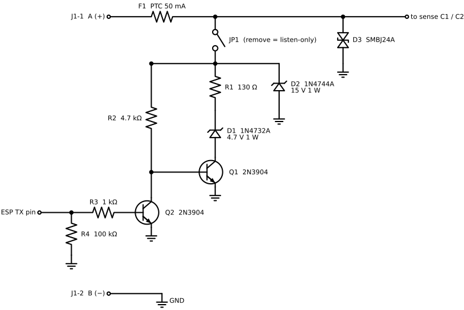
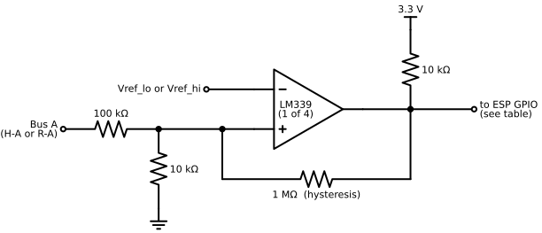
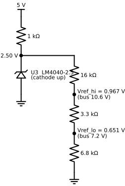

# Other ideas, untested

> ⚠️ **Nothing on this page has been built or tested.** These are design notes, published as a starting point for anyone who wants to take them further.
> The circuits were worked out on paper only, and the `navien_2wire_b` component has never run on hardware.
> For a design that has been built and tested, use the [interface board](README.md) and the `navien_2wire` component.

---

## Comparator board with a listen-only mode

The [interface board](README.md) replaces the wall remote, so it can't sit on the bus alongside it.
Its clamp is always across the line, and two clamps in parallel share the heater's 12.5 mA. The remote could no longer raise the line to send,
and the board would see only part of the heater's current.

This design adds a **listen-only mode**. With jumper JP1 pulled, only high-value dividers touch the line, so the board can be connected
**in parallel with the original remote** and decode everything both sides send. That's useful for working out the remaining protocol questions
(setpoint step rules, register `0xD3`, bit 6 of `0xC8`, error codes; see [../docs/protocol.md](../docs/protocol.md#open-questions)).
With JP1 fitted, it works as a remote replacement like the interface board.

| | Interface board | Comparator board (this page) |
|---|---|---|
| Status | built, bench-tested, running on a heater | **untested** |
| Isolation | yes: the ESP never shares ground with the heater | **no**: ESP ground = bus B |
| Listen-only (sniff alongside the original remote) | no | yes (pull JP1) |
| Parts | 2 optocouplers + 1 transistor + passives (~14) | LM393 + reference + 2 transistors + passives (~25) |
| Needs 5 V from the ESP board | no | yes (LM393 and reference) |
| Component | `navien_2wire` | `navien_2wire_b` |
| Receiver pin | `inverted: true` | `inverted: false` |

Because the ESP ground is tied to bus B, power the ESP board from its own isolated USB supply. Don't use a laptop or a device that shares
ground with other equipment while it's connected to the heater.

### Circuit



Two comparator channels (build this twice), with a shared reference:




| Ch | LM393 pins (+, −, out) | − input | Line threshold | ESP |
|---|---|---|---|---|
| C1 | 3, 2, 1 | Vref_lo 0.651 V | 7.2 V | RX pin |
| C2 | 5, 6, 7 | Vref_hi 0.967 V | 10.6 V | optional third GPIO: TX echo, or remote-sending detection in listen-only mode |

* **Idle and transmit** work like the interface board: R2 biases Q1 on from the bus, so the clamp D1 + R1 holds ≈ 6.5 V, and Q2 pulls Q1's base low to send.
  Q2 is a plain transistor rather than an optocoupler, which is why ESP ground = bus B.
* **Receive:** C1 compares the line (through a 100 k / 10 k divider) with a 7.2 V threshold, between the idle 6.5 V and the heater's 8 V. Its output is high while the heater sends.
* **JP1 out = listen-only:** the clamp is disconnected and only the 110 kΩ dividers touch the line. Connect the board in parallel with the original remote
  and set the component's *Bus mode* to **Listen**.

| Ref | Qty | Part | Notes |
|---|---|---|---|
| U1 | 1 | LM393 (DIP-8) | 8 = VCC (+5 V), 4 = GND |
| U2 | 1 | LM4040-2.5 | 2.5 V reference |
| Q1, Q2 | 2 | 2N3904 | |
| D1 | 1 | 1N4732A | 4.7 V 1 W zener |
| D2 | 1 | 1N4744A | 15 V 1 W zener |
| D3 | 1 | P6KE24CA (through-hole) or SMBJ24A | 24 V bidirectional TVS |
| F1 | 1 | PTC fuse, 50 mA hold | e.g. Bel Fuse 0ZRE0005FF |
| R1 | 1 | 130 Ω | tune 120–150 Ω |
| R2 | 1 | 4.7 kΩ | Q1 base bias |
| R3 | 1 | 1 kΩ | Q2 base |
| R4 | 1 | 100 kΩ | TX pin pull-down |
| — | 2 | 100 kΩ | input dividers (top) |
| — | 2 | 10 kΩ | input dividers (bottom) |
| — | 2 | 10 kΩ | comparator pull-ups to 3.3 V |
| — | 2 | 1 MΩ | hysteresis |
| — | 1 | 1 kΩ | LM4040 feed from 5 V |
| — | 1 | 16 kΩ | reference divider |
| — | 1 | 3.3 kΩ | reference divider |
| — | 1 | 6.8 kΩ | reference divider |
| — | 1 | 100 nF | LM393 VCC decoupling |
| JP1 | 1 | 2-pin header + jumper | |
| J1 | 1 | Premade JST VH 2-pin female pigtail | soldered to the board; plug goes onto CN12 |
| — | 1 | ESPHome board: ESP32, ESP8266 or RP2040 | needs a 5 V pin for U1/U2 |
| — | 1 | 5 V USB supply, ≥ 1 A | isolated (see above) |

Resistor totals: 100 kΩ ×3, 10 kΩ ×4, 1 kΩ ×2, 1 MΩ ×2, 4.7 kΩ, 130 Ω, 16 kΩ, 3.3 kΩ, 6.8 kΩ (×1 each).

There is no PCB for this design. The [bench bring-up](bring-up.md) steps apply with two differences: measure everything against bus B
(there's only one ground), and **RX goes high**, not low, when the heater sends.

### The `navien_2wire_b` component

`navien_2wire_b` is `navien_2wire` with two additions for this board:

* **Bus mode** select: **Listen** (decode only, never transmit) or **Master** (act as the remote). It boots in Listen until you choose Master once, then remembers the choice.
* **`*_on_bus` entities**, showing the master's writes: in Listen mode the original remote's, in Master mode the board's own.

| Platform | Keys added to `navien_2wire`'s |
|---|---|
| `sensor` | `setpoint_on_bus` |
| `binary_sensor` | `power_on_bus`, `preheat_on_bus` |
| `select` | `mode` (Listen / Master) |

Configuration is the same as `navien_2wire` with the component name changed, plus `inverted: false` on the receiver pin:

```yaml
external_components:
  - source: github://<you>/navien-esphome
    components: [navien_2wire_b]

remote_receiver:
  - id: navien_rx
    pin: { number: GPIO34, inverted: false }   # comparator output is high while the heater sends
    idle: 4ms
    filter: 100us
    tolerance: 35%
    dump: []

remote_transmitter:
  - id: navien_tx
    pin: GPIO25
    carrier_duty_percent: 100%

navien_2wire_b:
  receiver_id: navien_rx
  transmitter_id: navien_tx

select:
  - platform: navien_2wire_b
    mode: { name: Navien bus mode }

sensor:
  - platform: navien_2wire_b
    outlet_temperature: { name: Navien outlet temperature }
    inlet_temperature: { name: Navien inlet temperature }
    setpoint_on_bus: { name: Navien setpoint on bus }

binary_sensor:
  - platform: navien_2wire_b
    heater_link: { name: Navien heater link }
    burner: { name: Navien burner }
    power_on_bus: { name: Navien power on bus }
    preheat_on_bus: { name: Navien preheat on bus }

switch:
  - platform: navien_2wire_b
    power: { name: Navien power }
    preheat: { name: Navien preheat }
```

With the logger at `VERBOSE`, every decoded frame is logged as `RMT …` (from the master) or `HTR …` (from the heater).
